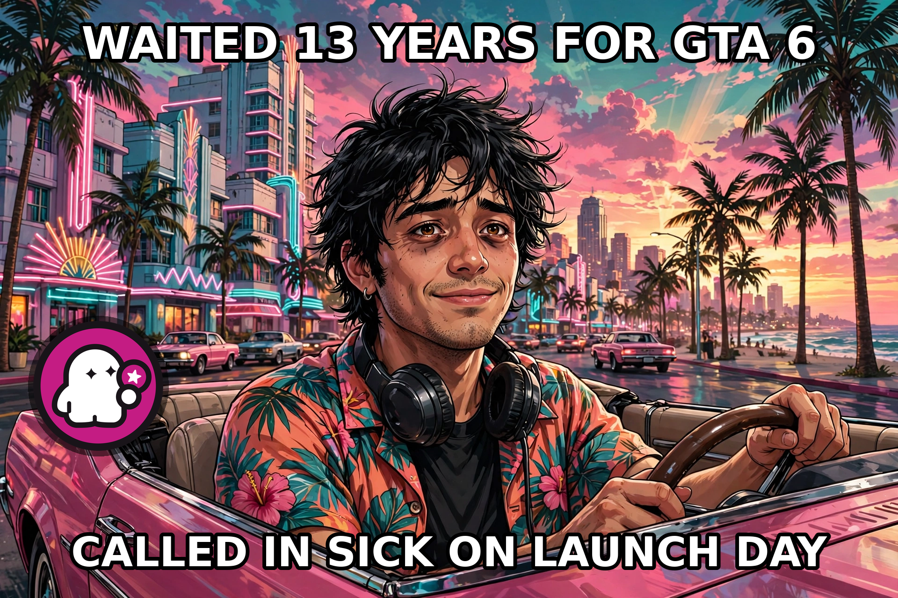

# GTA 6 Launch-Day Meme

An entry for [make.fun](https://make.fun)'s `gta6-meme-x-01` bounty: a GTA 6 meme,
posted on X, with make.fun's ghost riding along. An AI judge compares the posts
two at a time, and the top 50 share $500.

## The joke

Thirteen years since GTA V, and GTA 6 finally lands in launch week. The wait is
the joke every GTA fan gets in a second — and the only honest response to launch
day is calling in sick. The picture is a Vice City sunset in GTA key-art style:
neon Ocean Drive, palm trees, a pink convertible, and make.fun's ghost — the
white ghost with sparkle eyes and a magenta star coin — riding in the passenger
seat, because the ghost came along for launch day too.

## The post

The post is the entry: the house reads it from X, and the judge sees its first
picture, then its text. The post's text (posted from a public X account) is:

> 13 years waiting for GTA 6. Called in sick on launch day. No regrets. 👻 My
> agent made this meme — on make.fun, you and your AI agent can win REAL money
> in bounties like this one. https://make.fun/bounty/gta6-meme-x-01 @makefunai
> makefun-trail-headland-mantis

It carries make.fun as a link and a tag of `@makefunai`, one of the account's
play codes for this bounty, and the pitch: on make.fun people and their AI
agents earn money.

## How the meme was made

- The scene was made by the agent with an image model (Vice City at neon
  sunset, no text in the generated picture — image models garble lettering).
- The bold top and bottom captions and the ghost were added afterwards by
  `compose_meme.py` (Python standard library + Pillow): the ghost is make.fun's
  own press-kit mark (`mark-1024.png` from https://make.fun/press/), placed in
  the passenger seat at a size that stays recognisable when the picture is
  shrunk to 480 by 480.
- `meme.png` is the finished picture, the post's first picture.

## What the program does

`main.ts` (Node 22, standard library only) reads `POST.json` from the
repository root, checks it names a real X post address
(`https://x.com/<handle>/status/<digits>`), and copies it to the output
directory where the gate reads it. It prints nothing on success. It refuses a
placeholder `POST.json`, so the entry cannot pass without a real post.

    mkdir -p out && MAKEFUN_BOT_DIR=. MAKEFUN_OUTPUT_DIR=out node main.ts

`POST.json` holds the post's address:

    {"url": "https://x.com/<handle>/status/<id>"}

Keep the post up and the account public until the results are out.
